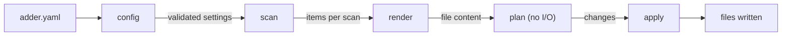

# Design

This document explains how adder is built and why. It records the decisions that shape the code, so that future features extend the design instead of working around it. The [roadmap](../ROADMAP.md) covers what adder will do; this covers how.

## Architecture



| Package | Responsibility |
| --- | --- |
| `internal/config` | Load `adder.yaml` and the `pack.yaml` of each pack it uses, validate them, and record where every setting is declared. |
| `internal/scan` | Parse Go source and return the declarations that match a scan. |
| `internal/render` | Execute a template into file content and format Go output. |
| `internal/header` | Write and recognize the generated-code header on adder's Go outputs. |
| `internal/plan` | Describe file changes before they happen, and apply them. |
| `internal/derive` | Connect the steps above for `adder derive`, `adder check`, and `adder explain`. |
| `internal/scaffold` | Resolve a generator's inputs, plan its new files, and derive outputs over them for `adder new`, `adder describe`, and `adder test`. |
| `internal/textcase` | Case conversion, for the template functions. |
| `internal/imports` | Package names for import paths, and removing unused imports from rendered Go. |
| `internal/diag` | Structured problems shared by every package. |
| `internal/pack` | Check and register the packs adder was built with: their files and template functions. |
| `internal/cli` | Commands, flags, output, and exit codes. |
| `typhonhill.dev/adder` | The public API: `Main` and `Pack`, for a repository's own build. Signal handling and build information. |
| `cmd/adder` | The binary: `adder.Main` without packs. |

Each step only depends on the steps before it. Commands are thin: they load configuration, call one pipeline, and print the result.

## Decisions

### 1. Plan before writing

Computing changes and making them are separate steps. `derive.Plan` returns a `plan.Plan` listing every output with its current and intended content, and does no writing. `Plan.Apply` writes the changes.

**Why:** `--dry-run`, `adder check`, diffs, JSON output, and editor integrations all need to know what *would* change. With one plan, each of them is a few lines on top of it rather than another copy of the pipeline.

**Consequences:** nothing is written unless every output renders. Unchanged files are never rewritten, so their modification times stay put.

### 2. File systems, not paths

The pipeline reads through `fs.FS`: the repository, the template directory, and the existing outputs are three separate file systems. The command line opens them with `os.Root`, which also confines every write to its root.

**Why:** tests run against in-memory file systems (`fstest.MapFS`), an editor integration can supply unsaved buffers, and no path in the configuration can reach outside its root.

**Consequences:** paths inside the pipeline are slash-separated `fs` paths. Operating system paths only appear at the edges, in the command line and in diagnostics.

### 3. Context everywhere

Every step that does I/O takes a `context.Context` and checks it between files.

**Why:** type-aware scans, watch mode, and editor integrations need cancellation. Adding a context parameter after the library API is public would be a breaking change.

### 4. Structured diagnostics

Every problem is a `diag.Diagnostic` with a stable code, a position, a message, and an optional hint. Several problems are reported together as a `diag.List`. The command line prints them as `file:line:column: message [code]`, and the same values serialize to JSON.

Positions follow two rules:

- A problem inside a file carries that file's path, joined to the directory the file system came from, so it opens from wherever adder ran.
- A problem with a declaration, such as a scan that matches nothing, has no file position of its own and is attributed to where it is declared in `adder.yaml`.

| Code | Meaning |
| --- | --- |
| `error` | A problem without a more specific code. |
| `io` | A file could not be read or written. |
| `yaml-syntax` | `adder.yaml` is not valid YAML. |
| `unknown-field` | `adder.yaml` has a key adder does not recognize. |
| `invalid-value` | A value has the wrong type or is malformed, such as an invalid pattern. |
| `missing-field` | A required setting is absent. |
| `unsupported-version` | The configuration declares a schema version this release does not understand. |
| `invalid-name` | A scan, var, generator, input, or pack use name does not have the required form. |
| `reserved-name` | A scan name collides with data adder provides: `Module`, `Vars`, `Inputs`, `Item`, or `Options`. |
| `unsafe-path` | A path is absolute, escapes its root, uses backslashes, or goes through a symbolic link. |
| `duplicate-path` | Two outputs write the same file. |
| `duplicate-name` | A name is taken twice, such as two generator tests with one name, a generator a pack use adds under a name already taken, or two partials defining one template. |
| `no-match` | A scan's directory pattern matched no directories, or a partial pattern matched no files. |
| `go-syntax` | A scanned Go file does not parse. |
| `template-syntax` | A template does not parse. |
| `template-exec` | A template failed while rendering, for example by referencing a missing field. |
| `invalid-output` | A template rendered Go that does not parse. |
| `invalid-directive` | An `//adder:` directive is malformed or repeated on one declaration. |
| `unknown-generator` | `adder new` was given a generator that `adder.yaml` does not declare. |
| `missing-input` | A required generator input was not given. |
| `invalid-input` | A generator input has the wrong type, fails a restriction, or is not declared. |
| `file-exists` | A file already exists where adder would write: a generator's new file, an output's path holding a file adder did not generate, or the `adder.yaml` that `adder init` writes. |
| `usage` | With `--json`, adder was invoked incorrectly, such as with an unknown flag. |
| `golden-mismatch` | A generator test's files differ from its golden files. |
| `type-check` | A type-aware scan could not load its packages: code that does not type check, a missing dependency, or no `go` command. |
| `unknown-pack` | The configuration uses a pack that adder was not built with. |
| `invalid-pack` | A pack cannot be registered, such as a duplicate pack, function, or scanner name. |
| `unknown-scanner` | A scan names a scanner that no pack provides. |
| `scanner` | A custom scanner failed. |
| `interrupted` | The command was interrupted, such as by Ctrl-C. |
| `deprecated` | A warning, not a problem: something deprecated was used, and still works ([decision 45](#45-deprecation-warnings)). |

**Why:** error text is for people and changes freely, but codes and positions are for tools. Keeping both from the start means JSON output, editor squiggles, and documentation links need no rework later.

### 5. Paths in the configuration

Every path in `adder.yaml` is slash-separated, relative, and confined to its root. Scan directories and output paths are relative to the repository root; template paths are relative to the directory holding `adder.yaml`. Paths are cleaned on load, so `./drivers/*` and `drivers/*` are the same.

**Why:** the same configuration must behave the same on every operating system, and generated headers name the template, so absolute or machine-specific paths would make output differ between machines.

### 6. Item fields mean one thing

`.Package` is the package name from the file's `package` clause. `.Dir` is the directory. They usually match, but not always: directory `go-redis` may hold `package redis`.

**Why:** once templates depend on a field, its meaning cannot change. Getting it right before release avoids a confusing pair such as `.Package` and `.PackageName` forever.

### 7. Deterministic output

The same repository and configuration produce byte-identical output everywhere:

- Scans run in name order, and their items are sorted by name, file, and receiver.
- Template line endings are normalized to `\n`, so a Windows checkout with CRLF endings renders the same.
- Output never includes timestamps, user names, or absolute paths.

### 8. The generated-code header is frozen

Go outputs carry `// Code generated by adder from <template>. DO NOT EDIT.`, which satisfies [Go's convention](https://go.dev/s/generatedcode). `header.Format` writes it and `header.Parse` reads it, from the same constants.

**Why:** adder finds its own outputs by their header. Scans use it to skip adder's outputs, so they never feed back into the next run, and `adder explain` and stale-output cleanup rely on it too. Changing the format would orphan every file generated before the change.

**Ownership:** `derive` never replaces a file that lacks adder's header with an output that has one. It reports `file-exists` instead, so a handwritten file at an output's path, or one a new scan item would land on, is never lost. Any template may be named, so renaming a template keeps working. Outputs of a file type without comments, such as JSON, get no header, so adder cannot tell its files from others and replaces them as before.

Only adder's own header counts. Another tool's `Code generated ... DO NOT EDIT.` comment in a template does not stop adder adding its header, which goes above it: without adder's header, scans would read the output back in, stale cleanup would never find it, and the ownership check could not protect it.

Outside Go, adder's header counts only on the first line after any preamble, where adder writes it. That decides which files stale cleanup removes, so a header quoted further down, as in documentation, never makes a file look generated.

### 9. Exit codes

| Code | Meaning |
| --- | --- |
| 0 | Success. |
| 1 | adder ran and found a problem. |
| 2 | adder was invoked incorrectly, such as an unknown flag or command, or a missing or invalid generator input. |
| 3 | `adder check` found derived outputs that are out of date. |

Stale outputs get their own code so CI can tell "regenerate and commit" apart from "something is broken".

### 10. Everything is internal except a small root package

All packages live under `internal/`, so their APIs can change freely. The root package holds the only public Go API, which starts with what packs and extensions need ([decision 18](#18-the-library-api-starts-with-packs-and-extensions)).

### 11. Go versions and dependencies

adder supports the two most recent Go releases. `go.mod` declares the older one in its `go` line, the minimum anyone importing adder needs, and the newest in its `toolchain` line for development. CI tests both.

Dependencies are kept to a minimum: cobra for the command line, `go.yaml.in/yaml/v3` for configuration, `golang.org/x/mod` for reading `go.mod`, and `github.com/rogpeppe/go-internal/diff` for `--diff` previews. Anything that shapes generated output, such as template functions and case conversion, is implemented in adder itself, because a dependency upgrade must never change what people's templates produce.

`golang.org/x/sys` is used only to turn on color in Windows consoles ([decision 32](#32-terminal-output)), and `golang.org/x/tools/go/packages` only to load types for scans that ask for them ([decision 37](#37-loading-types)). Tests also use `github.com/rogpeppe/go-internal/testscript`, from the same module as the diff code, and `github.com/santhosh-tekuri/jsonschema/v6` to check the schemas adder writes and ships. Neither is built into the binary.

### 12. One configuration file at the root

The configuration is a single, visible `adder.yaml` at the repository root. Only that name is accepted. adder finds it by walking up from the current directory, the way `go` finds `go.mod`, and its directory is the root. `--root` looks only in that directory, and `--config` names the file, making its directory the root unless `--root` is also given. Templates can live anywhere; their paths are relative to the configuration file.

**Why:** a root file is the norm for Go tools (`sqlc.yaml`, `buf.yaml`, `gqlgen.yml`, `.golangci.yml`), and a visible name signals that the file describes the repository's conventions rather than a tool's settings. Accepting other names later is additive; dropping one would break people.

### 13. Our own template functions, with Sprout's names

adder implements its template functions itself, using [Sprout](https://github.com/go-sprout/sprout)'s names wherever Sprout has an equivalent (`toSnakeCase`, `toCamelCase`, `toPascalCase`, `uniq`, `sortAlpha`), plus Go-specific case functions (`toGoPascalCase`, `toGoCamelCase`). Functions that are not deterministic, such as the current time, random values, or environment variables, are never included.

**Why:**

- Sprout's names are descriptive and correct. Sprig, its predecessor, names its PascalCase function `camelcase`, which matters in a Go generator where the first letter decides whether an identifier is exported.
- Depending on Sprig or Sprout would tie template behavior, and so people's output, to another project's release cycle. Sprout removed deprecated functions in a minor release.
- Neither library knows Go initialisms such as `ID` and `HTTP`.

Where adder needs a function neither library has, it picks a name that cannot be confused with theirs: `fieldValues` reads a field from a list of structs, unlike Sprig's map-based `pluck`.

### 14. Our own case conversion

Word splitting and case conversion live in `internal/textcase`:

- Words are separated by any rune that is not a letter or digit, at a lowercase-or-digit to uppercase change (`userID`), and before the last capital of an acronym followed by lowercase (`HTTPServer` is `HTTP` and `Server`).
- Digits stay with the word they follow (`HTTP2Server` is `HTTP2` and `Server`).
- The Go variants keep words that are already in capitals and capitalize the initialisms of staticcheck's ST1003 default list, the naming check Go teams most often run. adder's copy is frozen as of v1.0: a new initialism would rename identifiers in regenerated code, so other initialisms are written in capitals in the input, or handled by a repository's own function.

**Why:** case conversion is part of the output, so it is covered by the compatibility promise either way. Owning roughly a hundred lines with thorough tests is cheaper than pinning and policing a dependency.

### 15. Stale outputs are found by header, within each output's own path

When an output produces one file per item ([decision 24](#24-one-output-per-item)), adder removes files it previously generated that the current plan no longer produces. It looks only at files matching that output's path pattern, and only at files whose adder header names that output's template. Files without adder's header are never touched.

Files left behind by an output that was removed from the configuration are not found, because finding them would mean reading every file in the repository. `adder explain` reports such a file as belonging to no output, so it can be deleted by hand.

| Considered | Why not |
| --- | --- |
| A manifest or lockfile | State in the repository that can drift, conflicts in busy repositories, and awkward when outputs are not committed. |
| Searching the whole repository for headers | Slow, and cannot tell which configuration owns a file in a monorepo. |
| An owned output directory, deleted before generating | Only works when generated files live apart from handwritten code. |

### 16. Comment directives use Go's directive syntax

Directives look like `//adder:register name=s3 desc="Local disk"`: no space after `//`, a lowercase name, and `key=value` arguments with Go-style quoting when needed. Only directives in a declaration's doc comment count. A malformed directive, a directive repeated on one declaration, or an argument given twice is an `invalid-directive` problem rather than something adder guesses about. Bare words without `=` are rejected for now, so they stay available for a future meaning.

**Why:** Go's doc comment rules treat `//name:value` lines as directives, which godoc hides and gofmt keeps together, and the tools Go developers use most follow the same form: `//go:generate`, `//go:embed`, `//nolint:`, `//lint:ignore`. The `// +marker:` style from Kubernetes generators appears as text in documentation and is rarely used outside that ecosystem.

### 17. Type-aware scans are an explicit opt-in

A scan uses type information only when it sets `typeCheck: true`. Filters that need it, such as "implements this interface", fail validation on a scan without it, with a hint to enable it. Type-aware scans run the Go toolchain offline (`GOPROXY=off`, with read-only or vendored modules) and report missing dependencies instead of downloading them.

**Why:** type checking is much slower than parsing, needs code that compiles and dependencies in the module cache, and runs the toolchain. Enabling it automatically based on which filters are used would hide a performance and reliability cliff behind an innocent-looking change. Parsing stays the fast default.

How types are loaded is [decision 37](#37-loading-types).

### 18. The library API starts with packs and extensions

The module's root package, `typhonhill.dev/adder`, is a small public facade over the internal packages. Its first consumer is a repository that builds its own adder with packs ([decision 41](#41-generator-packs)), custom template functions, or custom scanners ([decision 42](#42-custom-template-functions-and-scanners)), so v0.5 exposes only that:

```go
// Main runs the command line with the given packs, and exits.
func Main(packs ...Pack)

// Pack is a set of generators, derive outputs, templates, functions, and scanners.
type Pack struct {
	Name     string             // how adder.yaml refers to the pack
	FS       fs.FS              // pack.yaml and its templates, usually an embed.FS; nil for a pack of only functions and scanners
	Funcs    map[string]any     // template functions
	Scanners map[string]Scanner // scanners, by the name scans use

	DeprecatedFuncs    map[string]string // what to use instead of each deprecated function
	DeprecatedScanners map[string]string // and of each deprecated scanner
}

type Scanner func(ctx context.Context, in *ScanInput) ([]any, error)
```

Scanners also get `ScanInput` and `Problem` ([decision 42](#42-custom-template-functions-and-scanners)).

`cmd/adder` is `func main() { adder.Main() }`. `--version` reports the version of the adder module from build information, in a repository's own build too.

Running adder from Go, such as loading a configuration and getting a plan back as Go values, waits for a consumer that needs it, such as an editor integration or an MCP server. Until then `--json` is the interface for tools. The internal packages stay internal.

| Considered | Why not |
| --- | --- |
| `Load`, `Derive`, and `Check` returning plans and diagnostics | Would make plans, changes, items, and reports public. They changed shape as recently as v0.4, and no consumer needs them yet. |
| Options as functions, such as `adder.Main(adder.WithPack(p))` | A struct gains fields without breaking callers, and a pack is data. Options for `Main` itself can be added when one is needed. |

**Why:** moving code is easy; committing to an API is not. After v1.0 a breaking change needs a new `/v2` import path, and today's internal APIs are shaped by a single consumer, the command line. They changed completely in one refactoring, which would have broken every user had they been public. `cmd/adder` is already public, because `go get -tool` depends on its path.

### 19. Scaffolding with `adder new`

Generators create new files that people then own. They live next to `derive` in `adder.yaml`:

```yaml
version: 1

vars:
  License: Apache-2.0

derive:
  scans:
    Drivers:
      dirs: ["drivers/*"]
      funcs: {exported: true, name: ^New$}
  outputs:
    - template: templates/drivers.go.tmpl
      path: drivers/drivers.gen.go

generators:
  driver:
    description: Add a storage driver
    inputs:
      name:
        help: Driver name, used as the package name
        pattern: ^[a-z][a-z0-9]*$
        unique: Drivers.Package
      summary:
        help: One-line description for the package documentation
        default: A storage driver.
      cache:
        type: bool
        help: Add an in-memory cache in front of the driver
    files:
      - template: templates/new/driver.go.tmpl
        path: drivers/{{ .Inputs.name }}/{{ .Inputs.name }}.go
      - template: templates/new/driver_test.go.tmpl
        path: drivers/{{ .Inputs.name }}/{{ .Inputs.name }}_test.go
      - template: templates/new/cache.go.tmpl
        path: drivers/{{ .Inputs.name }}/cache.go
        when: cache
    message: |
      Next, implement New in drivers/{{ .Inputs.name }}/{{ .Inputs.name }}.go.
```

```console
$ adder new driver name=gcs cache
created    drivers/gcs/gcs.go
created    drivers/gcs/gcs_test.go
created    drivers/gcs/cache.go
updated    drivers/drivers.gen.go

Next, implement New in drivers/gcs/gcs.go.
```

**Generators.** Each entry under `generators` is a command: `adder new <name>`. Names are lowercase words joined by hyphens, like command names.

**Inputs.**

- Input names are Go identifiers in lowerCamelCase. Each one is an argument with the same name, `packageName=x`, and the template field `.Inputs.packageName`. A bool input's bare name, `cache`, means `cache=true`.
- `type` is `string`, the default, or `bool`. Numbers and lists are left out until a real generator needs them; a string with a `pattern` covers most cases.
- A string input without a `default` is required. Bool inputs default to `false` and are never required, so there is no `required` setting.
- `pattern` must match the whole value. `values` lists the allowed values, and `valuesFrom: Drivers.Package` takes them from a scan. `unique: Drivers.Package` rejects values a scan already has, so two drivers cannot share a name. Both refer to a string field of scan items, checked when the generator runs.
- Values are validated, never transformed. A `transform` setting would hide what was typed; templates have case functions for that.
- Values come from arguments, from a JSON object with `--inputs file.json`, or from standard input with `--inputs -`. Arguments override the file. Unknown names are errors, and so is an input given twice.

**Files.**

- `template` is relative to the configuration file's directory. `path` is a template rendered with the same data and must stay inside the root after rendering.
- `when: cache` and `unless: cache` include a file depending on a bool input. They take an input name, not an expression, so the configuration never becomes a programming language.
- `ifExists` is `fail`, the default, or `skip`. There is no `overwrite`: once a file exists, people own it ([principle 4](../ROADMAP.md#principles)).
- Go files are gofmt-formatted but do not get a generated-code header, because they are meant to be edited.

**Template data.** Every template sees `.Vars`, `.Options`, `.Module`, and the scans by name; generator templates add `.Inputs`. `Inputs` and `Vars` join `Module` as reserved scan names.

**One plan for everything.** `adder new` builds a single plan containing the new files and every derived output that changes because of them. Derived outputs are recomputed against the repository with the new files overlaid in memory, so registries pick up the new code in the same run. Nothing is written unless the whole plan succeeds. `derive: false` on a generator opts out of the derive step.

**Previewing.** `--dry-run` prints the plan without writing. `--diff` also prints a unified diff of every change, with new files shown as additions, and implies `--dry-run`, like `gofmt -d`. Paths use `a/` and `b/` prefixes and new files come from `/dev/null`, so the output is a patch that `git apply` and `patch -p1` accept. Diffs come from go-internal's copy of Go's `internal/diff`, so previews match `gofmt -d`.

**Command line.** `adder new` loads `adder.yaml` before parsing the rest of the command line, and builds a subcommand for each generator, with its own `--help` listing its inputs and suggestions for mistyped names from the same library as every other command. Inputs are arguments, `name=value`, and flags belong to adder alone, so an input can have any name, and adder can add flags in any release without breaking a generator.

| Considered | Why not |
| --- | --- |
| Inputs as flags in kebab-case, `--package-name` | Inputs and adder's own flags share one namespace, so an input named `json` took over `--json`, and every flag adder added later could break a generator that has an input of that name. Reserving names only covers the flags that exist. |
| Freezing adder's flags for v1 | It would avoid clashes only by never adding a global flag or a flag to `adder new` until v2. |

**Writing.** New files are created exclusively: a file that appears between planning and writing makes the run fail rather than be overwritten.

**Problems.** New diagnostic codes are `unknown-generator`, `missing-input`, `invalid-input`, and `file-exists`. Mistakes in how a generator was invoked, such as a missing or invalid input, exit with status 2. A file that already exists exits with status 1. The plan gains a `skipped` status for files left alone by `ifExists: skip`.

**Shared configuration.** Two smaller additions serve generators and derived outputs alike:

- `vars` at the top level holds string values available to every template as `.Vars`, such as a license name. Names are Go identifiers. `.Vars` is present even when no vars are set, so templates can always use it.
- `partials` lists glob patterns of templates loaded into every template, so `{{ template "license" . }}` works anywhere. Partials are defined with `{{ define }}` and never rendered on their own.
  - Patterns use `path.Match` syntax without `**`, are relative to the configuration file's directory, and must each match a file. Directories they match are ignored.
  - Two partials defining the same name is an error, since which one wins would depend on file order. A template may redefine a partial's block for itself; each template renders from its own copy of the partials.
  - Problems inside a partial are reported at the partial's own file and line.

| Considered | Why not |
| --- | --- |
| Inputs at the top level of template data (`.name`) | Collides with scan names and leaves no room for new data; `.Inputs.name` is explicit. |
| A `required` setting | Redundant: a string without a default is required. |
| Conditions written as template expressions | Turns `adder.yaml` into a programming language. |
| An `overwrite` file policy | Breaks the promise that files people own are never rewritten. |
| Copying Go's `internal/diff` into adder | go-internal already exports the same code and keeps it in step with Go, so a copy only adds maintenance. adder copied it in v0.2, before depending on go-internal. |
| Other diff libraries | Myers diffs that differ from `gofmt -d`, Python difflib semantics, or character-level diffs that `git apply` cannot read. |

### 20. Richer scans without type checking

Go source alone says far more than names, so these additions parse files rather than type-check them.

**Directories.**

- `**` matches any number of directories: `internal/**/handlers`. Like `go`'s `./...`, it skips `testdata`, `vendor`, and directories whose names start with `.` or `_`.
- `exclude` lists patterns of directories to leave out, in the same syntax as `dirs`.

**Function filters.** These join `exported`, `firstParamName`, and `name`:

- `kind: func` or `kind: method` limits a scan to plain functions or to methods.
- `receiver: Worker` matches methods on `Worker` or `*Worker`.
- `firstParamType: context.Context` matches the first parameter's type as written, with its package resolved through the file's imports, so `ctx context.Context` and `c context.Context` both match. Types are written as Go writes them, with each package replaced by its full import path: `go.temporal.io/sdk/workflow.Context`, `*example.com/m/config.Config`, `[]string`. Imports without an alias are named as [decision 21](#21-unused-imports-are-removed-missing-ones-are-not-added) names them; packages that break that convention need type checking.
- `directive: register` matches declarations whose doc comment has `//adder:register`.

**Type declarations.** A scan can select types instead of functions, with a `types` block in place of `funcs`. It supports `exported`, `name`, `directive`, and `kind` (`struct`, `interface`, or `other` for any other type). Each scan selects exactly one kind of declaration.

**Item fields.** Items gain:

| Field | Description |
| --- | --- |
| `.ImportPath` | The package's import path, from the nearest `go.mod` ([decision 40](#40-multiple-configurations)). Empty when the repository has no `go.mod`. |
| `.Kind` | `func`, `method`, `struct`, `interface`, or `other` for any other type declaration. |
| `.Doc` | The doc comment, without directives. |
| `.Line` | The line of the declaration. |
| `.Directives` | Arguments of each `//adder:` directive, by name: `{{ index .Directives.register "name" }}`. A directive repeated on one declaration is an error. |
| `.Signature` | Parameters and results as written, such as `(ctx context.Context, name string) error`. |
| `.Params`, `.Results` | Each parameter and result, with `.Name` and `.Type` as written. |
| `.Fields` | For structs, each field with `.Name`, `.Type`, `.Tag`, and `.Embedded`. |

Items are a single type whose fields are empty when they do not apply, so templates and `fieldValues` work the same for every kind of declaration.

### 21. Unused imports are removed, missing ones are not added

Rendered Go files lose the imports they never refer to, after `gofmt`. Templates can list every import a file might need instead of wrapping each in `{{ if }}`. A package is referred to by its explicit name, or by the name goimports assumes from its path: the last element, skipping a major version such as `v2` and a `go-` prefix. Blank, dot, and cgo imports are always kept, and a name that might be a local variable keeps its import.

Missing imports are not added. That needs to know which package a name like `rand` or `template` means, and goimports answers it by searching the module cache, so the output would depend on the machine. A built-in table of the standard library would make it deterministic, at the cost of output that can change between adder releases.

| Considered | Why not |
| --- | --- |
| `golang.org/x/tools/imports` | Output would depend on the machine's module cache and the dependency's version ([decision 11](#11-go-versions-and-dependencies)). |
| Pruning by type checking | Needs the packages to build, which generated code often cannot do before it exists. |

**Why:** an unused import is a compile error, so removing one only changes output that was already broken, which makes it safe as a default.

### 22. JSON output

Every command accepts `--json`. It writes exactly one JSON object to standard output and nothing to standard error, whether the command succeeds or not, and exit codes stay as they are. Problems go in the object instead of being printed:

```json
{
  "changes": [
    {"path": "drivers/drivers.gen.go", "status": "updated"},
    {"path": "drivers/registry.gen.go", "status": "unchanged"}
  ],
  "problems": [
    {
      "code": "go-syntax",
      "message": "expected 'IDENT', found '{'",
      "pos": {"file": "drivers/s3/s3.go", "line": 3, "column": 6}
    }
  ],
  "warnings": []
}
```

- `problems` is always present, empty on success, and so is `warnings` ([decision 45](#45-deprecation-warnings)). Problems are the same `diag.Diagnostic` values the text output prints, with positions written the same way ([decision 4](#4-structured-diagnostics)).
- `changes` lists every file in the plan, unchanged ones included, so a tool sees the whole picture without a second command. Change paths are slash-separated and relative to the root. With `--diff`, each change that is not unchanged also has a `diff` field holding its unified diff.
- `adder derive` and `adder new` add `dryRun`, since `--diff` implies it, and `adder new` adds `generator` and `message`. [`commands.md`](commands.md#json-output) lists every command's fields.
- Mistakes in how adder was invoked, such as an unknown flag, become a problem with the new code `usage`, so a tool never has to parse help text. `--help` still prints text.
- Field names are lowerCamelCase. From v1.0, fields are only ever added.

**Why:** agents and scripts drive adder through this output ([principle 8](../ROADMAP.md#principles)). One object per run is simpler to consume than a stream, and adder plans everything before writing, so there is nothing to stream. `--json` matches `go list -json`, `go vet -json`, and `gh --json`.

| Considered | Why not |
| --- | --- |
| `--format json` or `-o json` | Only one machine format was planned at first. `--format` came later with the CI formats, and `--json` stays as its short form ([decision 46](#46-output-formats-for-ci)). |
| Problems on standard error as JSON lines | Two streams to read and interleave, for no gain when the run produces one result. |
| A version field in the object | The output follows adder's semantic versioning like everything else in the compatibility promise. |

### 23. Discovering generators and outputs

Three read-only commands let people and agents learn what a repository offers without reading `adder.yaml`.

**`adder list`** prints every generator with its description, and every derived output with its template and path:

```console
$ adder list
generators
  driver    Add a storage driver
outputs
  drivers/drivers.gen.go    from templates/drivers.go.tmpl
```

**`adder describe <generator>`** prints a generator's inputs, its files, and its message. Allowed values from `valuesFrom` and existing values for `unique` are computed from the scans, so they are current. With `--json`, it includes `inputSchema`, a JSON Schema (draft 2020-12) for the object `--inputs` accepts. That is the shape MCP uses for tool inputs, so an agent can fill it in directly:

| Input setting | JSON Schema |
| --- | --- |
| `type: string` / `type: bool` | `"type": "string"` / `"type": "boolean"` |
| `help` | `description` |
| `default` | `default` |
| no `default` on a string | listed in `required` |
| `pattern` | `pattern`, anchored as adder anchors it. adder validates with Go's regular expressions, which differ from JSON Schema's ECMAScript dialect only in rarely used syntax. |
| `values`, `valuesFrom` | `enum` |
| `unique` | `"not": {"enum": [...]}` with the values that already exist |

The schema sets `additionalProperties: false`, as `--inputs` rejects unknown keys.

**`adder explain <file>`** says where a file comes from: the output in `adder.yaml` and its position, the template, the scans the template refers to by name, and whether the file is up to date. A file without adder's header is reported as not generated by adder. One whose header names a template no output uses is reported as belonging to no output ([decision 15](#15-stale-outputs-are-found-by-header-within-each-outputs-own-path)). Scans are found by reading the template's parse tree, including its partials, for fields named after a scan. A template that reaches a scan indirectly, such as through `index`, is not attributed to it.

**Why:** an agent that can list, describe, preview with `--dry-run --json`, and run a generator never has to guess a repository's conventions. `explain` answers the first question anyone asks about a generated file: what do I edit instead?

### 24. One output per item

An output with `each` renders its template once for every item of a scan, with the item available as `.Item`. Its `path` is then a template rendered for each item:

```yaml
derive:
  outputs:
    - template: templates/mock.go.tmpl
      each: Stores
      path: "{{ .Item.Dir }}/{{ .Item.Name | toSnakeCase }}_mock.gen.go"
```

- `each` names a scan. Templates still see everything else ([decision 19](#19-scaffolding-with-adder-new)). `Item` joins the reserved scan names.
- Two items rendering to the same path is a `duplicate-path` problem, so a path that does not use `.Item` fails as soon as a scan has two items.
- `path` is only a template on outputs with `each`. A single output's path is written literally, so it can never move without the configuration changing, except in `pack.yaml`, where `.Options` fills it ([decision 41](#41-generator-packs)).
- Each output with `each` must have a template no other output uses, and a path whose file type has a generated-file header ([decision 25](#25-generated-file-headers-for-other-languages)), because stale files are found by that header.

**Stale files.** Files the output no longer produces are removed ([decision 15](#15-stale-outputs-are-found-by-header-within-each-outputs-own-path)). The candidates are files whose path matches the output's `path` with each template action replaced by a wildcard that may span directories, and whose header names the output's template. adder searches from the longest directory in `path` before the first action, and skips `testdata`, `vendor`, and directories starting with `.` or `_` as `**` does.

The plan gains a `removed` status. `adder derive` deletes removed files, `adder check` treats them as stale, and `--diff` shows them as deletions to `/dev/null`.

| Considered | Why not |
| --- | --- |
| A templated path on every output | A single output whose path depends on data could move and leave its old file behind. |
| Asking for a separate glob of files the output owns | Repeats the path in a second form that can drift from it. |

### 25. Generated-file headers for other languages

Outputs in languages other than Go get adder's header in their own comment syntax, chosen by file extension from a built-in table. The text is the same as the Go header, so `Code generated by adder from <template>. DO NOT EDIT.` marks every generated file:

| Comment | Files |
| --- | --- |
| `// ...` | Go (unchanged), C, C++, C#, Dart, Java, JavaScript, Kotlin, Protocol Buffers, Rust, Scala, Swift, TypeScript |
| `# ...` | Dockerfile, HCL and Terraform, Makefile, Nix, Perl, PowerShell, Python, R, Ruby, shell scripts, TOML, YAML |
| `-- ...` | Haskell, Lua, SQL |
| `/* ... */` | CSS, Sass |
| `<!-- ... -->` | HTML, Markdown, SVG, Vue, XML |

- The header goes on the first line, or after a leading `#!` line, an XML declaration, or Markdown front matter, which must stay first. A UTF-8 byte order mark stays first too, before all of them.
- A file that already has adder's header where adder writes it is left alone. Another tool's generated-code comment gets adder's header above it ([decision 8](#8-the-generated-code-header-is-frozen)).
- File types without comments, such as JSON, and extensions not in the table get no header. They cannot use `each`, and `adder explain` cannot identify them.
- The table is frozen within v1: a file type without a header never gains one ([compatibility](compatibility.md)).

**Why:** tools from linguist to code review treat files with this marker as generated, and adder needs the header to find its own files. A built-in table keeps the configuration free of comment syntax.

### 26. Symlinks

- Scans skip symbolic links to files and directories alike, as `go` skips linked directories in `./...`. This also rules out loops.
- adder never writes, creates, or removes a file through a symbolic link. An output or new file whose path, or any directory on it, is a link inside the root is an `unsafe-path` problem. `os.Root` already rejects links that lead outside the root.
- Templates, partials, and `adder.yaml` may be links, since reading them cannot change anything.
- A `go.mod` or `adder.yaml` that is a link counts as the file it leads to, as `go` treats a linked `go.mod`, so boundaries, `.ImportPath`, and `./...` agree ([decision 40](#40-multiple-configurations)). Scans read through `os.Root`, so there a link that leads outside the root counts as no file.

**Why:** writing through a link changes a file somewhere else, which may be one that people own ([principle 4](../ROADMAP.md#principles)).

### 27. Build constraints in scans

Scans skip files whose build constraints can never be satisfied, such as `//go:build ignore`. Constraints are evaluated the same way on every machine: custom tags are false, and `GOOS`, `GOARCH`, `unix`, `cgo`, and Go version tags may take any value. A file is skipped only when no combination of those satisfies it. `buildTags` on a scan lists custom tags to treat as true, such as `integration`. File name suffixes such as `_linux.go` are platform constraints, so they never exclude a file.

**Why:** evaluating constraints for the machine adder runs on would make output differ between a Mac and a Linux CI runner ([decision 7](#7-deterministic-output)). Files for one platform belong in the scan, and files marked `ignore` or for a custom tag usually do not.

### 28. More template functions

Functions Sprout also has keep its names and argument order, with the value last, so they work at the end of a pipeline:

| Function | Example | Result |
| --- | --- | --- |
| `join` | `join ", " .Names` | `a, b` |
| `trimPrefix` | `trimPrefix "Handle" .Name` | `Users` for `HandleUsers` |
| `trimSuffix` | `trimSuffix "Handler" .Name` | `Users` for `UsersHandler` |
| `replace` | `replace "-" "_" .Name` | `go_redis` for `go-redis` |
| `quote` | `quote .Name` | `"s3"`, quoted as Go writes strings |
| `indent`, `nindent` | `nindent 4 .Doc` | each line indented by four spaces, after a newline with `nindent` |
| `plural` | `plural "driver" "drivers" (len .Drivers)` | `driver` for exactly one, `drivers` for zero or more |

`quote` takes exactly one value, where Sprout's joins several, so a template written for Sprout fails rather than renders differently.

Functions Sprout lacks get names that do not collide with it:

| Function | Example | Result |
| --- | --- | --- |
| `groupBy` | `groupBy "Dir" .Handlers` | a list of `.Key` and `.Items`, sorted by key |
| `sortBy` | `sortBy "Iota" .Colors` | the items sorted by a string or number field, keeping the order of equal ones |

`groupBy` takes a string field, like `fieldValues`, and returns a list rather than a map, so groups keep a stable order and work with `range` and `fieldValues`.

| Considered | Why not |
| --- | --- |
| `pluralize` and `singularize`, working out plurals from English rules | Correct plurals need a list of irregular and uncountable words that is never finished, and every addition changes people's output. Templates write plurals instead, such as `{{ .Name }}s`, or take irregular ones from a directive argument such as `//adder:register plural=people`. |

### 29. Prompts for missing inputs

When `adder new` is missing a required input, standard input and standard error are both terminals, and neither `--json` nor `--inputs -` is given, adder asks for the value instead of failing:

```console
$ adder new driver
name: Driver name, used as the package name
  must match ^[a-z][a-z0-9]*$, and not be one of: disk, s3
> gcs
```

- Only required inputs are asked for. Optional inputs and bools keep their defaults, so the result is the same as giving them as arguments.
- Inputs with `values` or `valuesFrom` list the choices, numbered, and accept a number or a value.
- A value that fails validation is explained and asked for again. Nothing is written until every input is valid, and Ctrl-C cancels.
- Prompts are plain lines, with no arrow-key menus.

**Why:** a person running a generator by hand should not have to look up its inputs first, while scripts, CI, and agents, which have no terminal, keep getting a `missing-input` problem.

| Considered | Why not |
| --- | --- |
| A prompt library such as huh or survey | Several dependencies, raw terminal handling, and Windows differences, for menus that line prompts cover. |
| Asking for every input | Tedious for generators with many optional inputs, and gives a different result than the same command with arguments. |

### 30. Generator tests

A generator can declare tests: sample inputs and the files it should create.

```yaml
generators:
  driver:
    # inputs, files, and message as before
    tests:
      - name: with-cache
        inputs: {name: example, cache: true}
        want: testdata/generators/driver/with-cache
```

`adder test` runs every test, or only those of the generators it is given. Each test plans its generator against the repository like `--dry-run` and compares the files the generator creates with the files under `want`, which mirror their paths in the repository. A missing, extra, or different file fails the test with a diff and the new code `golden-mismatch`, and `adder test` exits with status 1. `adder test --update` rewrites the `want` directories instead.

- `want` is relative to the configuration file's directory. Under a `testdata` directory, `**` scans and Go tooling ignore it.
- Inputs are validated like an `--inputs` file, against the generator's inputs.
- Derived outputs are not compared, because they depend on everything in the repository and would fail whenever unrelated code changed.
- Tests run against the real repository, so `unique` and existing files still apply. Test inputs should use names that will not exist, such as `example`.

**Why:** a generator is code that a team relies on, and templates break silently when a scan field or function changes. Golden files make a generator's output reviewable in pull requests.

### 31. Checking the configuration

**JSON Schemas for `adder.yaml` and `pack.yaml`.** `schema/adder-v1.json` describes `adder.yaml` for `version: 1`, and `schema/pack-v1.json` describes `pack.yaml`, both in draft-07, which editors support best. `adder init` writes a `# yaml-language-server: $schema=` line pointing at `https://typhonhill.dev/adder/schema/adder-v1.json`, and the examples carry the same line, so the URLs must never move. They are on the project's own domain, like the module path, so that moving the repository does not break every `adder.yaml` that points at them. The site serves copies of the files in `schema/`, and a workflow fails when the copies differ from `main`, checked on every change to `schema/` and weekly. A SchemaStore listing for files named `adder.yaml` waits for the launch, once v1.0 has made the schema stable.

- The adder schema is written by hand, so it carries descriptions and examples. A test checks that its properties match the configuration types exactly, in both directions.
- The pack schema is generated from it by a test, which fails when the file is out of date and rewrites it with `-update`. Every value in a `pack.yaml` may instead be an option's value, `{option: name}`, so the pack schema is the adder schema with each value made "this, or an option", without `vars`, `packs`, or generator tests, and with `options`.
- Where adder accepts a null, such as `scans:` with only comments below it, so does the schema, since `adder init` writes such files. Keywords beside a `$ref` are ignored in draft-07, so a `$ref` that needs a description or another rule is wrapped in `allOf`.
- A test validates every `adder.yaml` and `pack.yaml` in the examples, fixtures, and test scripts that adder loads, and checks that the schemas reject common mistakes.

The schema files are draft-07 for editors, while the `inputSchema` that `adder describe --json` returns is draft 2020-12, the dialect MCP uses for tool inputs. adder's own validation stays the authority, since it reports positions and checks references between settings, such as a generator's `unique` naming a scan that exists.

| Considered | Why not |
| --- | --- |
| `adder validate`, checking everything but whether outputs are up to date | `adder derive --dry-run` already runs every scan, renders every output, and writes nothing, exiting 0 or 1, which is what a repository that does not commit its outputs needs from CI. |

**Why:** a schema gives editors completion and validation for `adder.yaml`, and catches mistakes before adder runs. Writing it is also a last review of what v1.0 freezes.

### 32. Terminal output

- `--quiet` prints only problems. `--verbose` also lists unchanged files and how many items each scan found. They cannot be combined.
- Status words and problem codes are colored when the stream is a terminal, `NO_COLOR` is unset or empty, `TERM` is not `dumb`, and `--json` is not given. On Windows, adder enables the console's color support through `golang.org/x/sys`, and prints without color if that fails.
- `adder completion bash|zsh|fish|powershell` prints a completion script. It completes generator names with their descriptions, the inputs of each generator as `name=`, input values from `values` and `valuesFrom`, and generated files for `adder explain`. Completion reads `adder.yaml` and runs scans, but never writes. It completes nothing when the configuration does not load, rather than printing errors into the shell.

**Why:** these follow what people expect from a modern command line, and none of them changes what adder writes.

### 33. Releases

Pushing a `v*` tag runs GoReleaser in GitHub Actions:

- **Binaries:** builds for Linux, macOS, and Windows on amd64 and arm64, with `-trimpath`, `CGO_ENABLED=0`, and file times taken from the commit, so rebuilding a tag produces identical archives. The version comes from the build information Go embeds from the tag, as `adder --version` already reads it, so no linker flags are needed.
- **Integrity:** `checksums.txt` is signed with keyless cosign, as a Sigstore bundle. Each archive has an SPDX SBOM and a GitHub artifact attestation with SLSA build provenance, which `gh attestation verify` checks.
- **Homebrew:** a cask in `typhonhilldev/homebrew-tap`, pushed with a fine-grained token that can write only to that repository. The binaries are not notarized by Apple, so the cask clears macOS's quarantine flag on install.
- **Image:** `ghcr.io/typhonhilldev/adder`, for linux/amd64 and linux/arm64, tagged with the version, its minor and major versions, and `latest`, and signed with cosign. It is the official `golang` Alpine image, pinned by digest and updated by Dependabot, with adder added, so scans with `typeCheck` work in it too. Its caches are in `/tmp`, so it runs as any user, and it starts in `/src`, where a repository is mounted.
- **Checking the build:** a pull request that changes how releases are built runs the whole build as a snapshot, which publishes nothing, and builds the archives twice to check that they are identical. `SECURITY.md` shows users how to verify a release.
- **Release notes:** the changelog's section for the tag. The release fails when that section is missing, so no release ships without its changelog.
- **Permissions:** the release job alone gets `contents: write`, `id-token: write`, and `attestations: write`.

`go install` and `go get -tool` keep working from source as before.

| Considered | Why not |
| --- | --- |
| The SLSA GitHub generator | GitHub's artifact attestations give the same provenance natively, with less workflow. |
| A Homebrew formula | GoReleaser now publishes prebuilt binaries to Homebrew as casks and has deprecated formulas for them. |
| Version set with `-ldflags -X` | Duplicates what Go's build information already records. |
| A minimal image, such as distroless | Smaller, but without Go, so scans with `typeCheck` fail in it. CI systems without Go are the reason for an image at all. |
| Two images, minimal and with Go | Twice the images to build, sign, and document, for a size that matters little next to a CI job's other images. |

### 34. Integrations and coding agents

- **`go generate`:** one `//go:generate go tool adder derive` directive anywhere in the module is enough, since adder finds `adder.yaml` from any directory ([decision 12](#12-one-configuration-file-at-the-root)) and `derive` regenerates every output.
- **pre-commit:** `.pre-commit-hooks.yaml` defines `adder-check` and `adder-derive`, built from source with `language: golang`. They run on every commit and ignore the changed file names, because a change anywhere can affect a scan. The documentation leads with a local hook running `go tool adder` instead, since it uses the version `go.mod` pins and a repository's own build with its packs, which the published hooks cannot.
- **GitHub Action**, at the launch: `action.yml` at the repository root, a composite action, runs `adder check` by default, or the `command` input with extra `args`, always with `--format github` ([decision 46](#46-output-formats-for-ci)). It runs `go tool adder` when `go.mod` declares adder as a tool, including a repository's own build with packs, so CI runs the version the repository pins. Otherwise it downloads the release for the runner, checks it against `checksums.txt` and its attestation with `gh attestation verify`, and runs that; the `version` input picks the release, and defaults to the action's own. Workflows reference the action by an exact version, `typhonhilldev/adder@v1.2.0`, or a commit, and Dependabot proposes each new release: the repository's tags never move ([decision 33](#33-releases)), so there is no `@v1` tag, which is also how a compromised action reaches every workflow at once.
- **GitLab CI job**, at the launch: `ci/gitlab/adder.yml`, a configuration file with `spec:inputs` (`version`, `command`, `args`, `stage`, `working-directory`) that a repository includes with `include:remote` from a release tag, with its `integrity` hash, which a test keeps in step with the documentation. The job runs in the release's image and uses `go tool adder` when `go.mod` declares it, writing a Code Quality report with `--format gitlab`. GitLab also has a CI/CD Catalog, a searchable directory of reusable jobs like GitHub's Marketplace. A job listed there must live in a project on gitlab.com and be released from it, which would mean a second project to keep in step with each release. The included file works the same for users, so a catalog listing waits until GitLab users ask for it.
- **CI jobs:** documented jobs for GitLab CI and GitHub Actions that run `adder check --diff`, and variants that read `--json` with `jq` to show problems, warnings, and out-of-date files on the pull request: as annotations on GitHub, and as a Code Quality report on GitLab. Both read reports with and without directory patterns. `--format github` and `--format gitlab` replace the `jq` ([decision 46](#46-output-formats-for-ci)).
- **Coding agents:** a guide in `docs/agents.md`, and an `AGENTS.md` section to copy into a repository. It tells agents to discover generators with `adder list --json` and `adder describe`, preview with `--dry-run --json`, run `adder derive` after adding code, never edit files marked `DO NOT EDIT`, and use `adder explain` to find the template to change instead.

### 35. Documentation and examples (planned, launch)

- **Site:** built with Hugo and the Hextra theme from `site/` and deployed to GitHub Pages from `main`. Hugo is a single Go binary and Hextra installs as a Hugo module, so the documentation needs no Node toolchain. The site holds guides, references, recipes, a comparison with other tools, and a guide to migrating from a hand-rolled generator.
- **References are generated:** the configuration reference comes from the JSON Schema and the function reference from the function table, by a program in `internal/tools/docgen`. Function examples run as tests, and a test fails when the generated pages are out of date, the same way `adder check` does.
- **Examples:** the examples v1.0 adds to `examples/` ([decision 43](#43-reaching-v10)) grow to cover more cases, such as CLI commands and workflow engine wiring, and recipes on the site walk through them.
- **Comparisons** state the version of each tool compared and the date, and link to its documentation.
- **Issues and pull requests** use templates: the bug report form asks for `adder --version`, how adder is installed, the relevant `adder.yaml`, the command, and its output, and the feature request form asks for the problem before the proposal. Questions go to Discussions, vulnerabilities to private advisories, and conduct reports to `conduct@typhonhill.dev`, an address on the project's domain rather than anyone's own.

Before then, the README and `docs/` are the documentation ([decision 43](#43-reaching-v10)), and the site renders the same `docs/` files.

### 36. Testing adder itself

- **End to end:** `testscript` scripts in `cmd/adder/testdata/script` run the real command against small repositories written inline, covering each command's text and JSON output and exit codes. Scripts for packs build a repository's own adder with the Go command, offline, with adder's module replaced by the checkout under test. A versioned pack is published to a module proxy in the script's work directory, so two unrelated repositories can share it and upgrade it separately, as the v0.5 milestone asks, without touching the shared module cache. Today's command tests stay as unit tests for details that scripts express poorly.
- **Fuzzing:** fuzz tests for configuration loading, header parsing, directive parsing, and import pruning check that no input panics, that problems point inside the input, and that pruning keeps gofmt-formatted Go parsing. Seed corpora run with every test run, and a weekly workflow fuzzes each target for five minutes.
- **Performance budget:** a benchmark builds a repository of 1,000 packages and 10,000 functions and runs `derive` over it. The budget is 500 ms on GitHub's standard runners. CI fails above four times the budget, which catches a slowdown by an order of magnitude without failing on noisy timing. Parallel parsing is only added if the budget is missed.

### 37. Loading types

Scans with `typeCheck: true` load their packages with `golang.org/x/tools/go/packages`, the loader gopls and staticcheck use. It runs `go list` and the compiler to build export data for dependencies, and type checks the scanned packages from source with the standard library's `go/types`, so results follow the Go release adder was built with, not the loader's version.

**One environment everywhere.** Results must not depend on the machine ([decision 7](#7-deterministic-output)), so adder runs the `go` command with the environment it inherits, but fixes every setting that changes which files are checked:

| Setting | Value | Why |
| --- | --- | --- |
| `GOOS`, `GOARCH` | `linux`, `amd64`, or the scan's `platform`, such as `platform: windows/arm64` | Files for different platforms cannot be checked together, so one platform is chosen, the same on every machine. |
| `CGO_ENABLED` | `0` | cgo runs a C compiler with flags from the source, and its results depend on the machine. |
| `GOFLAGS` | `-mod=readonly`, or `-mod=vendor` with a `vendor/modules.txt` | Nothing from the environment changes which files are checked. The scan's `buildTags` are passed as `-tags`. |
| `GOPROXY` | `off` | Nothing is downloaded: a missing dependency is reported, not fetched. |
| `GOTOOLCHAIN` | `auto` | The toolchain `go.mod` asks for is used when the `go` on `PATH` is older, as `go` does, but only from the module cache, since `GOPROXY` is off. Forcing `local` would break every repository that relies on toolchain switching. |
| `GOWORK` | the root's `go.work` if it has one, otherwise `off` | A committed workspace is honored; a local one above the repository is not. |
| `GO111MODULE`, `GOEXPERIMENT` | `on`, and empty | Module mode always, and no experiments that change which files build. |

The parse-based rule for build constraints ([decision 27](#27-build-constraints-in-scans)) does not apply to these scans, since the platform decides; a directory whose files are all for other platforms is scanned and has nothing to find. With `includeTests`, each package's test variant is loaded, so its `_test.go` files and its external test package are scanned too. Running `go list` and the compiler never executes the repository's code, and with cgo off no C compiler runs either ([principle 7](../ROADMAP.md#principles)).

**Filters.** On a scan with `typeCheck: true`:

- `firstParamType` compares types, not spelling, so it matches through any import alias, a dot import, or a type alias.
- `implements: io.Writer`, on a `types` block, selects types whose values or pointers implement the interface, written as `firstParamType` writes types, such as `example.com/m/driver.Driver`. Items gain `.Pointer`, true when only a pointer to the type implements it, so a registry can write `&{{ .Name }}{}` or `{{ .Name }}{}` as needed.
- `implements` and the `platform` setting on a scan without `typeCheck: true` fail validation with a hint to add it.

**Generators.** `adder new` passes the files it is about to create to the loader as an overlay, so type-aware scans see them before they are written, as parse-based scans do.

**Problems.** Code that does not type check, a missing dependency, and a missing `go` command are `type-check` problems, at the position the toolchain reports. Each is reported once: the compiler's copy of a type error is dropped, and so is the "could not import" error in a package that imports one that failed, whose own problem says why. adder's own outputs are type checked with their package, since the code needs them, but never become items.

| Considered | Why not |
| --- | --- |
| Our own loader on `go list -export` and `go/importer` | Reimplements what `go/packages` gets right, including overlays and test variants. |
| The machine's `GOOS` and `GOARCH` | Output would differ between a Mac and a Linux CI runner. |
| Checking every platform and merging the results | Several times slower, and items that exist on one platform only have no single right answer. |

### 38. Constant and variable scans

A scan can select constants and variables with a `values` block, in place of `funcs` or `types`:

```yaml
scans:
  Colors:
    dirs: [color]
    values: {kind: const, type: Color}
```

- Filters are `kind` (`const` or `var`), `exported`, `name`, `type`, and `directive`.
- Each name is its own item, so `var a, b = 1, 2` gives two. A directive in the doc comment of a grouped declaration applies to every name in it; one on a single name applies to that name and replaces the group's directive of the same name.
- `.Kind` is `const` or `var`. New fields are `.Type`, the type as written, and `.Value`, the expression as written. In a `const` group, a name without a type or value repeats the previous ones, as Go does, so `.Type` is `Color` for every member of `Red Color = iota; Green; Blue`, while `.Value` stays empty for the repeated ones. `.Iota` is the name's position in its `const` group, its value of `iota`.
- `type` matches `.Type` as written. With `typeCheck: true` it matches the declared or inferred type, so `const Red = Color(1)` counts too.

**Why:** enums and lookup tables are among the most common things generators read, such as an enum's `String` method or a list of feature flags. `.Iota` covers the common `iota` enum without evaluating expressions, which needs type checking, and `sortBy "Iota"` lists an enum in declaration order while items keep one order for every scan ([decision 7](#7-deterministic-output)).

### 39. File scans

A scan can list files that are not Go source with a `files` block, in place of `funcs`, `types`, or `values`:

```yaml
scans:
  Migrations:
    dirs: [db/migrations]
    files: {name: '^[0-9]+_.*\.sql$'}
```

- `name` matches the file name, including its extension. Without it, every file in the directories is listed.
- Items have `.Name`, the file name, `.Dir`, `.File`, and `.Kind`, which is `file`. File contents are not read.
- Files adder generated, symbolic links, and files whose names start with `.` are skipped. `includeTests`, `buildTags`, and `typeCheck` do not apply and fail validation.
- With `each`, an output can render one file per listed file, such as a Go wrapper per SQL migration.

**Why:** generated registries often index files rather than code: migrations, fixtures, templates, schemas. Listing them needs no parser, which keeps scans to Go source and plain file lists ([non-goals](../ROADMAP.md#non-goals)).

### 40. Multiple configurations

A repository can hold several `adder.yaml` files, such as one per service in a monorepo. Each stays independent, with its own directory as its root ([decision 12](#12-one-configuration-file-at-the-root)).

**Boundaries.** Wildcards in scan directories, and the search for stale files, do not descend into a directory that has its own `adder.yaml` or `go.mod`, the way `./...` stops at nested modules. A directory named outright is still scanned. `.ImportPath` uses the nearest `go.mod` between an item's directory and the root, so items in a nested module get that module's path. `.Module` stays the root's.

**Running several.** `derive`, `check`, `list`, and `test` accept directory patterns as `go` does: `adder check ./...` runs every `adder.yaml` at or below the current directory, skipping `testdata`, `vendor`, and directories starting with `.` or `_`, and `adder check services/api` runs one. Without arguments, commands use the nearest configuration, as now. `--root` and `--config` cannot be combined with patterns.

- Configurations run one after another, and a problem in one does not stop the others.
- Text output prefixes each path with its configuration's directory, relative to the current directory, so `services/api/drivers/drivers.gen.go`, and diffs use the same paths, so the patch applies from where the command ran.
- With `--json`, the object holds `configs`, one entry per configuration with its `config` path and the command's usual fields, including its own `problems`, so a tool can tell which configuration a problem belongs to. The top-level `problems` holds only problems that concern no one configuration, such as a pattern that matches nothing.
- `adder test` takes directory patterns and generator names together, told apart because patterns contain a slash or are `.`, `..`, or `...`. A named generator runs in the configurations that have it.
- The exit status is the most serious across configurations: 2 for a usage mistake, then 1 for a problem, then 3 for stale outputs.

`adder explain <file>` uses the configuration nearest the file rather than the current directory.

| Considered | Why not |
| --- | --- |
| A root configuration that includes the others | Another list to keep in sync, and the nested configurations could no longer run on their own. |
| One configuration for the whole repository | Services owned by different teams would share one file, and scans would cross module boundaries. |

### 41. Generator packs

A pack shares generators, derive outputs, and templates across repositories. It is a Go package, so it is versioned, downloaded, and verified like any other dependency.

```go
// github.com/acme/adder-packs/store/pack.go
package store

import (
	"embed"

	"typhonhill.dev/adder"
)

//go:embed pack.yaml templates
var files embed.FS

var Pack = adder.Pack{Name: "store", FS: files}
```

```yaml
# github.com/acme/adder-packs/store/pack.yaml
version: 1
options:
  dirs: {type: list, help: Directories that each hold one driver}
  out: {help: Directory for the registry and new drivers}
derive:
  scans:
    Drivers:
      dirs: {option: dirs}
      typeCheck: true
      types: {implements: github.com/acme/store.Driver}
  outputs:
    - template: templates/registry.go.tmpl
      path: "{{ .Options.out }}/registry.gen.go"
generators:
  driver:
    description: Add a storage driver
    inputs:
      name: {pattern: "^[a-z][a-z0-9]*$", unique: Drivers.Package}
    files:
      - template: templates/driver.go.tmpl
        path: "{{ .Options.out }}/{{ .Inputs.name }}/driver.go"
```

A repository that uses the pack builds its own adder, and names the pack in `adder.yaml`:

```go
// tools/adder/main.go
package main

import (
	"typhonhill.dev/adder"
	"github.com/acme/adder-packs/store"
)

func main() { adder.Main(store.Pack) }
```

```yaml
# adder.yaml
version: 1
packs:
  drivers:
    pack: store
    with: {dirs: ["drivers/*"], out: drivers}
```

```console
$ go mod edit -droptool typhonhill.dev/adder/cmd/adder
$ go get -tool ./tools/adder
$ go tool adder new driver name=gcs
created    drivers/gcs/driver.go
updated    drivers/registry.gen.go
```

**Building.** The repository's build takes the place of the `tool` line for `typhonhill.dev/adder/cmd/adder`, which is dropped because two tools named `adder` would make `go tool adder` ambiguous. `go tool adder` keeps working, now with the repository's packs. The Go command caches the build, so only the first run after a change compiles. `go.mod` and `go.sum` pin and verify the pack's version, private modules work as they do for any dependency, and tools such as Dependabot update packs like other modules. A stock adder that reads a configuration naming a pack it was not built with reports `unknown-pack`, with a hint to run the repository's own build.

**Using a pack.** Each entry under `packs` is one use, named like a generator. `pack` is the pack's `Name`, and `with` gives its options. A pack can be used more than once, such as once per service directory, and each use is independent.

**Options.** A pack declares `options` with the same settings as generator inputs ([decision 19](#19-scaffolding-with-adder-new)): `help`, `default`, `pattern`, and `values`, with `type` `string`, `bool`, or `list`, a list of strings. Options are given only in `with`, so `valuesFrom` and `unique` do not apply. An option without a default is required. Mistakes in `with` are configuration problems, such as `invalid-value` and `missing-field`, reported at the use in `adder.yaml`.

- In `pack.yaml`, a mapping whose only key is `option`, such as `dirs: {option: dirs}`, is replaced by that option's value before the configuration is validated, so a list can fill `dirs` and a string can fill `implements`. Problems with the result are reported at the use's `with` value. Scan directories are not templates, and one containing `{{` is rejected with a hint to use an option.
- Templates in the pack, output paths, generator file paths, and messages see the options as `.Options`. Paths of outputs without `each` may use `.Options` and template functions, and render when the configuration loads, so two uses writing one file are reported then, at the second use.
- There are no overrides. A use cannot change a pack's scans, outputs, or generators beyond its options; a repository that needs more defines its own outputs or forks the pack.

**Scope.** A pack's scans belong to each use. The pack's templates see them by name, with `.Options` and `.Module`, and nothing else from the repository: not its scans, `vars`, or partials. The repository's own templates do not see the pack's scans. `Options` joins the reserved scan names. `pack.yaml` holds `version`, `options`, `partials`, `derive`, and `generators`; a pack cannot declare `vars` or use other packs.

**Paths.** Template paths and `partials` patterns in `pack.yaml` are relative to the root of the pack's `FS`. Scan directories and output paths are relative to the repository root and confined to it, like those in `adder.yaml` ([decision 5](#5-paths-in-the-configuration)).

**Generators.** A use's generators become `adder new` commands under their own names. A name already taken, by the repository or another use, is a `duplicate-name` problem; the use renames its generators with `rename: {driver: cache-driver}`.

**Tests.** `pack.yaml` does not declare generator tests, because golden files belong to a repository and `adder test --update` cannot write into a pack. A repository tests a used pack's generators under the use, as `tests: {driver: [...]}` in the form of [decision 30](#30-generator-tests). A pack's module can keep an example repository that does so in its own CI.

**Templates from a pack.** A repository's own outputs and generator files can render a pack's template with `pack: store` next to `template`. The template sees the repository's data as usual, and the pack's partials.

**Headers.** Outputs a use renders are marked `// Code generated by adder from templates/registry.go.tmpl in pack store for drivers. DO NOT EDIT.`, and a repository's own outputs rendering a pack's template leave out the use. The use is named because stale files of an output with `each` are found by their header ([decision 15](#15-stale-outputs-are-found-by-header-within-each-outputs-own-path)): without it, two uses of one pack would remove each other's files. The pack's version is left out, so upgrading a pack only rewrites the files whose content changes. The header still has the frozen form ([decision 8](#8-the-generated-code-header-is-frozen)).

**Discovery.** `adder list` and `adder explain` name the use and the pack each output or generator comes from.

**Problems.**

- A problem in a pack's file carries the pack's name as `pack` in JSON and in text as `pack store: pack.yaml:3:5: message [code]`, with the path relative to the pack's `FS`.
- New codes: `unknown-pack` for a configuration that names a pack adder was not built with, and `invalid-pack` for a pack that cannot be registered, such as two packs with the same name, a name that is not lowercase words joined by hyphens, or an `FS` without `pack.yaml`.

| Considered | Why not |
| --- | --- |
| Pack versions in `adder.yaml`, fetched with `go mod download` | A second lock file that update tools do not understand, and packs with Go code would still need a build of their own. |
| `adder pack add` copying a pack's files into the repository | Updates become manual, and copies drift from their source. Packs could not carry Go code. |
| Go plugins (`plugin` package) | Linux and macOS only, and the plugin must be built with exactly the same toolchain and dependency versions as adder. |
| Extensions as separate processes, or WebAssembly modules | A wire protocol to keep stable, and for WebAssembly a runtime dependency and a narrower Go toolchain for authors. |
| Overrides of a pack's scans and outputs | Merge rules are the hardest part of a configuration to keep compatible, and a pack could no longer rely on its own scans. |

**Why:** the Go module system already solves versioning, downloading, verification, private hosting, and updates, and the repositories adder serves already depend on it. A repository's own build is also the only way to run Go code from a pack, which custom functions and scanners need ([decision 42](#42-custom-template-functions-and-scanners)).

### 42. Custom template functions and scanners

A pack can add template functions and scanners, written in Go. A pack without an `FS` is only functions and scanners, so a repository adds its own with a pack in its `tools/adder/main.go`:

```go
adder.Main(adder.Pack{
	Name:     "local",
	Funcs:    map[string]any{"routeName": routeName},
	Scanners: map[string]adder.Scanner{"routes": scanRoutes},
})
```

**Functions.** A pack's functions are available to every template, the repository's and every pack's. A name used by a built-in function, including those and the keywords of `text/template`, or by another pack is an `invalid-pack` problem when adder starts, so a new built-in function can clash with a pack's; packs should use prefixed names ([compatibility](compatibility.md)). Functions follow the rules of `text/template`. They must be deterministic, as built-in functions are ([decision 13](#13-our-own-template-functions-with-sprouts-names)), which adder cannot check. Function names in paths are checked when a path renders rather than when `adder.yaml` loads, since loading does not know which functions the build has.

**Scanners.** A scan can use a registered scanner instead of `funcs`, `types`, `values`, or `files`:

```yaml
scans:
  Routes:
    dirs: ["api/*"]
    scanner: {name: routes, with: {prefix: /v1}}
```

```go
type ScanInput struct {
	FS   fs.FS    // the repository, with files adder new is about to write
	Dirs []string // the scan's directories, expanded, slash-separated, and in order
}

// Decode decodes the scan's `with` settings into v, rejecting unknown fields.
func (in *ScanInput) Decode(v any) error

// Problem is a problem a scanner reports at a position in a repository file.
type Problem struct {
	File         string // slash-separated, relative to the repository root
	Line, Column int
	Message      string
	Hint         string
}
```

- `dirs` is optional for a scanner, which may read the files it needs from `FS`. Directories are expanded as for any scan, with the same boundaries ([decision 40](#40-multiple-configurations)).
- A scanner returns its items as structs, pointers to structs, or `map[string]any`, in a deterministic order, which adder keeps. Templates, `each`, `valuesFrom`, `sortBy`, and `groupBy` read fields by name from either.
- `Decode` reports problems in `with` at their position in `adder.yaml`, with the usual codes.
- A scanner's error is reported at the scan with the new code `scanner`. A `Problem`, or several joined with `errors.Join`, is reported at its own position instead, so a scanner can point at the file that is wrong.
- Scanner names are lowercase words joined by hyphens and, like function names, unique across packs. A scan naming an unknown scanner is an `unknown-scanner` problem, with a hint to run the repository's own build.
- Scanners must not write files or depend on anything outside `FS`, so that `check` and `derive` agree. adder cannot check this either.

| Considered | Why not |
| --- | --- |
| Scanner items as a public `adder.Item` type | Would freeze the item model of the built-in scans for every scanner. Structs and maps let a scanner return whatever fields its templates need. |
| A `Scanner` interface | A function is enough today. A scanner that needs more than one method can be added later as an optional interface. |
| Functions available only to their own pack's templates | A repository using a pack's templates in its own outputs would have no way to reach the functions those templates need. |

**Why:** a repository's code sometimes holds information no general scan can find, such as routes registered in a call chain or names in a non-Go file format. Custom functions and scanners let a repository or pack handle those cases without adder growing a feature for each.

### 43. Reaching v1.0

v1.0 makes the promises in [Compatibility](#compatibility), detailed in [`compatibility.md`](compatibility.md), binding, so it is about getting them right rather than adding features. Four steps come before the release, in this order, because each can change what the next one describes.

**1. Review everything v1.0 freezes.** Every name and behavior the compatibility promise covers is read once more, asking whether it should change while change is still free:

- the `adder.yaml` and `pack.yaml` schemas: every key, default, and validation rule
- template data: scan item fields, `.Module`, `.Vars`, `.Inputs`, `.Options`, `.Item`
- template function names, argument order, and behavior
- the generated-code header
- diagnostic codes, exit codes, and the JSON output of every command
- the root package's Go API: `Main`, `Pack`, `Scanner`, `ScanInput`, and `Problem`

Where the module lives is already settled: since v0.6.0 it is `typhonhill.dev/adder`, a path on a domain the project owns, so the repository can move between GitHub accounts without breaking imports.

Each change the review proposes is decided on its own. Those accepted ship before v1.0, listed under **Changed** or **Removed** in the changelog.

**2. Try adder on a production codebase.** adder replaces the hand-rolled generator of a large repository in a local trial before the schema freezes, since a real generator is the best test of whether the schema is right. Nothing from that repository is published. What the trial finds comes back as general changes to adder, with examples of its own.

The trial replaced a generator of about 430 lines of Go with 68 lines of `adder.yaml`. Every derived file matched the old generator's output byte for byte, apart from the header, and its tests passed. It found no reason to change the schema, and one thing that makes moving to adder harder than it should be: old generated files block `adder derive` with a hint that does not say why. adder now explains the refusal, and the move is documented ([decision 44](#44-moving-from-a-hand-rolled-generator)).

**3. Rewrite the documentation, with examples.** The README became a short front door, in the manner of well-known Go projects: a tagline, what adder does in three steps, one example, a list of features, installation, and links. The reference moved to `docs/`, one file per topic:

| File | Covers |
| --- | --- |
| `docs/getting-started.md` | A first registry, a first generator, and `adder check` in CI. |
| `docs/configuration.md` | Scans, directives, outputs, generators, vars, and partials. |
| `docs/templates.md` | Template data, scan items, and functions. |
| `docs/extending.md` | A repository's own build, packs, functions, and scanners. |
| `docs/commands.md` | Commands and flags, monorepos, exit codes, and JSON output. |
| `docs/migrating.md` | Moving from a hand-rolled generator ([decision 44](#44-moving-from-a-hand-rolled-generator)). |
| `docs/compatibility.md` | What v1.0 promises, and the support and deprecation policy. |
| `docs/integrations.md` | go generate, pre-commit, GitHub Actions, and GitLab CI. |
| `docs/agents.md` | How coding agents find and run generators. |

GitHub renders these today, and the documentation site at the launch ([decision 35](#35-documentation-and-examples-planned-launch)) renders the same files instead of duplicating them.

`examples/` holds ten small repositories, each its own module with `adder.yaml`, templates, Go code, and committed outputs, which the documentation links to. Each shows one capability and is named after it, from `registry-from-functions` to `monorepo`, and its README says what it shows, how, and what to try. A test runs `adder check` and `adder test` on every `adder.yaml` in them and `go build` and `go vet` on every module, with adder built from the same commit, so an example that drifts from adder fails the build.

**4. Write the policies.** `docs/compatibility.md` states the support and deprecation policy:

- Within v1, a setting, field, function, or code is only deprecated, never removed, as [compatibility](compatibility.md#deprecation) describes, with warnings where it is used ([decision 45](#45-deprecation-warnings)).
- adder supports the two most recent Go releases ([decision 11](#11-go-versions-and-dependencies)), as Go does. Moving the minimum to a newer release is not a breaking change.

| Considered | Why not |
| --- | --- |
| `adder migrate` in v1.0 | Version 1 is the only schema, so there is nothing to migrate yet. |
| Freezing without a production trial | Freezing is a one-way door, and the tests are written by the people who wrote the schema. |
| Keeping the reference in the README | Seven hundred lines that mix a pitch, a tutorial, and a reference serve none of them well. |
| A code of conduct in v1.0 | It matters once others join, which the launch invites. It arrives then, with a way to report problems that publishes no one's address. |

### 44. Moving from a hand-rolled generator

A repository moving to adder already has the files its old generator wrote. adder never replaces a file without its header ([decision 8](#8-the-generated-code-header-is-frozen)), and that stays true: moving is a one-time step, done in one change.

1. Write `adder.yaml` and the templates, and remove the old generator.
2. Delete the files the old generator wrote at the outputs' paths.
3. Run `adder derive`, and commit its outputs with the rest of the change.

Everyone else gets adder's files by pulling. Where the old files were ignored by git, the pull replaces each checkout's copies. Where they were neither committed nor ignored, git refuses to pull over them, and each checkout deletes them once. `docs/migrating.md` walks through these steps with an example.

**A clearer refusal.** When `file-exists` blocks a file that carries another tool's `Code generated ... DO NOT EDIT.` comment, its hint says so: the file was generated by another tool, and deleting it once lets adder generate it. Files without such a comment keep today's hint, since people may have written them by hand.

| Considered | Why not |
| --- | --- |
| `adder derive --adopt`, replacing files without adder's header at outputs' paths | Moving happens once per repository, not per checkout, and a flag whose purpose is to bypass the ownership check weakens the guarantee that adder never replaces a file it did not write. |
| Recognizing another tool's generated-code comment as adder's own | Any tool's generated file at an output's path would be replaced silently. |

### 45. Deprecation warnings

adder reports every use of something deprecated as a warning, the way a web framework marks an endpoint on its way out, so people learn about a replacement while the old way still works rather than when it is removed ([compatibility](compatibility.md#deprecation)).

**Warnings.** A warning is a diagnostic with the code `deprecated`, at the position of the use, saying what to use instead. Warnings never stop a command or change its exit code. They are printed to standard error before any problems, as `file:line:column: warning: message [deprecated]`, and with `--json` every report has a `warnings` list beside `problems`; with directory patterns, each configuration's report has its own. Each warning is reported once per run, and none are printed while answering shell completions.

**What warns.**

| Deprecated | Reported at |
| --- | --- |
| A setting of `adder.yaml` or `pack.yaml`, a value of one, or relying on a setting's default | The setting, the value, or the mapping that leaves the setting out |
| A template function or data field, built in or from a pack | Each use in a template, and in the partials it calls |
| A command or flag | The run that uses it |
| A generator or an input, with `deprecated` | `adder new` running it, or given it |
| A pack option, with `deprecated` | The `with` line of each use that gives it |
| A pack's function or scanner, in `DeprecatedFuncs` or `DeprecatedScanners` on `adder.Pack` | Each call, and each scan naming the scanner |

adder's own deprecations are tables in the code, empty until something is deprecated. A deprecated input or option must have a default, so that leaving it out keeps working, and `--help`, `adder list`, and `adder describe` mark what is deprecated, with `"deprecated": true` in the input schema.

**Why:** a pack is shared by many repositories and upgraded with `go get`, so without warnings the first sign that an option is going away is a build that breaks when it is removed. Reporting at the place of each use, with the replacement, turns that into a change a person can make whenever it suits them.

| Considered | Why not |
| --- | --- |
| Cobra's `Deprecated` fields for commands and flags | Cobra prints the notice to the command's output, which would break `--json`. |
| Failing on warnings, as `adder check --strict` | Nothing is deprecated yet, and CI can already read `warnings` from `--json`. It can be added if people ask. |
| Warning about generator tests that use a deprecated generator or input | A generator is still tested until it is removed, and its tests would warn on every run. |
| Hiding deprecated flags from completion | Cobra hides only flags marked with its own `Deprecated`, which prints to the output. |

**Known limits.** adder's own tables are empty, so three cases cannot occur yet, and are left for when the first deprecation needs them: a deprecated value that reaches a pack through an option is not reported, since `pack.yaml` is checked before options fill it in; YAML anchors, aliases, and merge keys are matched as written rather than as resolved; and a global flag such as `--verbose` can be deprecated only under each command's path, without a note in its help.

### 46. Output formats for CI

`--format` chooses how a command reports, on every command:

| Format | Output |
| --- | --- |
| `text` | The default: what adder prints today. |
| `json` | One JSON object ([decision 22](#22-json-output)). `--json` is its short form. |
| `github` | The text output, plus a [workflow command](https://docs.github.com/actions/reference/workflows-and-actions/workflow-commands) on standard output for each problem, warning, and out-of-date output, which GitHub shows as annotations on the pull request. |
| `gitlab` | A [Code Quality](https://docs.gitlab.com/ci/testing/code_quality/) report on standard output, to save as the job's `codequality` report, which GitLab shows in the merge request. |

- Each annotation is at the diagnostic's position and names its code: `::error file=api/routes.go,line=3,col=2,title=adder: go-syntax::expected 'IDENT'`. Problems are errors and warnings are warnings. A position inside a pack has no file in the repository, so its annotation has none either, and appears on the run instead of a line.
- An output that `adder check` finds out of date is an error at its path, titled `out-of-date`. That name belongs to the formats, not to the diagnostic codes: out-of-date outputs are changes, not problems, in every other format.
- Paths are relative to the repository root, `GITHUB_WORKSPACE` or `CI_PROJECT_DIR`, or else the current directory, so annotations land on the right files in a monorepo and from a subdirectory.
- The Code Quality report gives problems the severity `major` and warnings `minor`, and each entry a fingerprint from its code, path, line, and message, so GitLab tracks it across runs.
- Exit codes are the same in every format. `--json` with another `--format` is a usage error.
- `--format json` is how the documentation asks for JSON, with `--json` kept as its short form. `--json` is planned for removal in v2. It is deprecated, with a warning, only once `--format json` has been out for a few releases, and once a global flag can be deprecated with a note in its help ([decision 45](#45-deprecation-warnings)), so that the warning points at a replacement every adder in use already has.
- GitHub limits how many annotations a step shows on the pull request; every one is still in the log.

adder only writes these formats when asked. The [GitHub Action](#34-integrations-and-coding-agents) passes `--format github`.

**Why:** the `jq` that turned `--json` into annotations was long, and every repository would copy it. The formats are small and stable, GitHub's and GitLab's own, and adder already has every position they need.

| Considered | Why not |
| --- | --- |
| Annotations whenever `GITHUB_ACTIONS` is set | Changes the output of existing CI steps that never asked for it. |
| Only annotations with `--format github`, without the text output | The log is where people read a failure first, and GitHub shows only so many annotations per step. |
| `out-of-date` as a diagnostic code | Out-of-date outputs are changes in every other format, with exit code 3 rather than 1, and a code would report them as problems in some places and changes in others. |
| A SARIF format | Code scanning is for security findings that persist; adder's problems are fixed in the same pull request. |

## Compatibility

From v1.0, semantic versioning covers the `adder.yaml` and `pack.yaml` schemas, template data and functions, the generated-code header, commands and flags, diagnostic codes, exit codes, JSON output, and the root package's Go API. It does not cover the wording of messages or gofmt's formatting. [`compatibility.md`](compatibility.md) states each promise, its exceptions, and the deprecation and Go version policies, and tests named `TestFrozen...` pin the lists it freezes.
